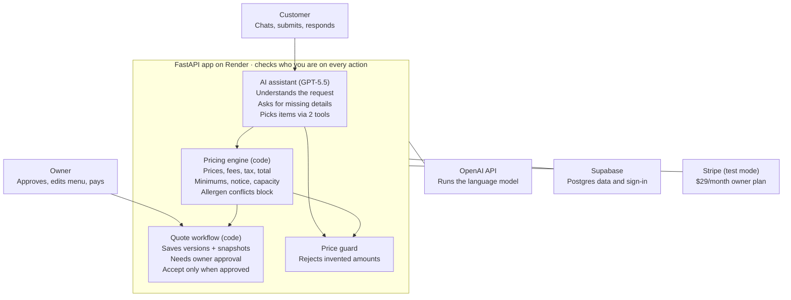

# Quote Kitchen — Product Requirements Document

Quote Kitchen turns a customer's catering request, written in plain language, into an accurate, owner-approved quote in minutes. An AI assistant handles the conversation, code calculates every price and checks every rule, and the owner approves before anything is final.

**Team:** Mohamed Ali, Jeffery Chen, Andrew Chu, Flora Jeong, Jay Yu (MGMT440)

**Status:** live; kept current through the build.

## Problem

Small caterers lose hours each week turning vague inquiries into priced quotes. A request like "lunch for 40 next Friday, one nut allergy, about $800" means chasing missing details, then applying minimums, notice periods, fees, tax and availability by hand. Slow replies lose orders, and manual math causes pricing errors.

AI fits the language part: understanding free-form requests and asking follow-up questions. It must not set prices or approve orders, so those stay with code and the owner.

## Goals and success metrics

Success means an owner sends accurate quotes faster than by hand, and the AI never invents a price.

| Goal | How we measure it | Target |
| --- | --- | --- |
| Accurate quotes | Totals that differ from the pricing code | 0 |
| AI asks instead of guessing | Held-out test conversations fully passed | ≥ 95% |
| Safe under pressure | Prompt injection or discount requests change the total | Never |
| Faster quoting | Time from inquiry to owner-approved quote | Under 1 hour (pilot) |
| Owner in control | Quotes accepted without owner approval | 0 |
| Viable business | Owners paying the $29/month subscription | First paying owner after a pilot |

**Out of scope:** approval emails or texts, taking payment for food, multiple caterers, staffed events, calendar booking and deposits.

## Users

- **Owner (pays):** runs a small, single-location caterer with a published menu and no sales staff. Wants fewer emails, no math errors and the final say on every quote.
- **Customer:** an office manager or event host ordering for a group. Writes requests in plain language, often with missing details or dietary needs. Wants a fast, trustworthy price.

Both use one sign-in. The server decides who is the owner, and customers can only see their own quotes.

## Requirements

The customer chats, code prices the request, the owner approves, and the customer accepts or declines.

**Customer**

1. Describe the event in plain language; the assistant asks for anything missing and never guesses.
2. See a live, itemized draft quote with fees, tax and total, plus any problems that block submission.
3. Submit, then find the quote later in My Quotes, even after signing out.
4. Accept or decline only once the owner has approved the current version.

**Owner**

5. Review incoming requests with flags and a checklist, then approve or reprice.
6. Edit menu names, prices and availability; saved quotes keep their original prices.
7. Archive and restore quotes.
8. Subscribe to the $29/month plan (Stripe test mode).

**Guardrails**

- The AI can only search the menu and call the pricing code; it never sets a price or approves a quote.
- Any dollar amount in an AI reply that the pricing code did not produce is rejected.
- Minimums, notice periods, availability and allergen conflicts are enforced in code and rechecked on submit.
- Every page checks who the user is; another customer's quote returns "not found."
- Limits on model calls and message counts cap cost; outages show a clear message instead of failing silently.

## How we evaluate the AI

We test the assistant on 22 held-out customer conversations it was never tuned on. They cover complete requests, missing details, rule violations, an impossible budget and safety cases such as allergies and prompt injection. A case passes only if the outcome, the extracted details and every safety check are right. The model must pass at least 95%; the deployed model passed 22 of 22.

## Architecture

The AI handles language, code handles numbers and rules, and the owner handles judgment.

One Python web app runs everything. Each saved quote keeps a snapshot of the prices it used, so a later menu change never alters an agreed total.

## Risks

| Risk | Mitigation |
| --- | --- |
| AI invents a price or discount | Prices come only from code; a price guard rejects any other amount |
| AI guesses a missing detail | Required details are checked in code before submit |
| Allergen mistake | Conflicts and unclear allergies block approval until clarified |
| Owners don't trust the drafts | Owner approves every quote; a review checklist shows every flag |
| Slow or unavailable AI | Clear fallback message; limits on calls and time per reply |

**Assumptions:** menu and published rules come from one real caterer (shown under a generic name). Unpublished rules, such as the delivery fee, are documented assumptions, and the availability calendar is invented for the demo.

## Roadmap and open questions

1. Pilot with one caterer to measure time saved.
2. Real address lookup for delivery fees and tax.
3. Email or text the customer when a quote is approved.
4. Live availability, and turning an accepted quote into a booking with a deposit.
5. Full subscription management: renewals and cancellations.
6. Broader AI testing, including repeated runs and real inquiries.
7. Support a second caterer.

**Open questions:** Is $29 a month the right price? Is a reply time of about 16 seconds acceptable to customers?
